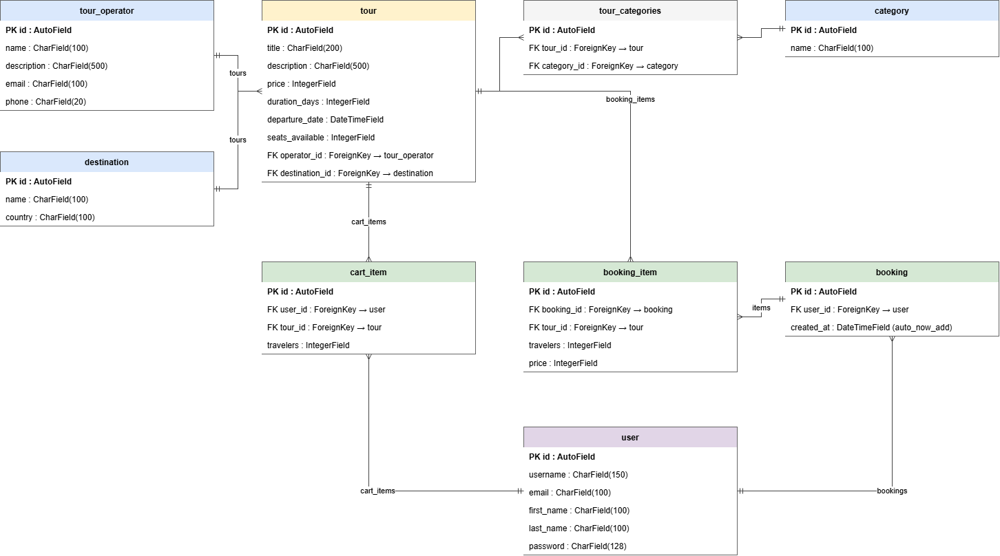

# TourHub - каталог турів від туроператорів

## Опис

TourHub - сайт, де зібрані тури від різних туроператорів. Відвідувач може переглянути список турів, знайти потрібний за назвою, відфільтрувати за туроператором, напрямком і типом відпочинку та відсортувати за ціною чи популярністю. На сторінці туру - детальна інформація: дати, тривалість, ціна, кількість вільних місць, опис, туроператор.

Є сторінки туроператорів (на сторінці оператора - усі його тури) і напрямків (усі тури в цей напрямок). Дані (тури, туроператорів, напрямки) можна додавати, редагувати й видаляти.

Зареєстрований користувач має профіль із даними про себе та історією бронювань. Він додає тури в кошик (із вказанням кількості мандрівників) і натискає «Забронювати» - бронювання створюється одразу, без оплати та додаткових даних. Також є сторінка «Про нас» з контактами, умовами бронювання та скасування.

## Загальні правила API

- Базовий префікс: `/api/v1`
- Дані передаються у форматі JSON.
- Ресурси - іменники у множині, дія визначається HTTP-методом.
- Оновлення - лише `PUT` (передається повний обʼєкт).
- Ціни - цілі числа, гривні. Дати - ISO 8601 (`2026-12-20T08:00:00`).
- Користувацькі ендпоінти (`/users/me`, `/cart`, `/bookings`) працюють з поточним авторизованим користувачем; без авторизації повертають `401`.
- Помилки мають вигляд `{ "detail": "опис помилки" }`.
- Додавання, редагування й видалення турів, туроператорів і напрямків поки доступне без обмежень; розмежування прав буде додано разом з авторизацією.

Статус-коди: `200` OK, `201` створено, `400` некоректні дані, `401` не авторизовано, `404` не знайдено.

---

## Ендпоінти

### Тури (`tours`)

| Метод | Ендпоінт | Призначення |
|---|---|---|
| GET | `/api/v1/tours` | Список турів із пошуком, фільтрами, сортуванням |
| GET | `/api/v1/tours/{id}` | Сторінка туру |
| POST | `/api/v1/tours` | Додати тур |
| PUT | `/api/v1/tours/{id}` | Оновити тур |
| DELETE | `/api/v1/tours/{id}` | Видалити тур |

**GET `/api/v1/tours`** - query-параметри (усі необовʼязкові):

| Параметр | Опис |
|---|---|
| `search` | пошук за назвою туру або назвою туроператора |
| `operator` | id туроператора |
| `destination` | id напрямку |
| `category` | id категорії |
| `sort` | `price_asc`, `price_desc`, `popular` |
| `page`, `limit` | сторінка та кількість на сторінці |

Приклад: `GET /api/v1/tours?destination=2&category=1&sort=price_asc&limit=20&page=1`

Response `200`:

```json
[
  {
    "id": 1,
    "title": "Тиждень у Єгипті: все включено",
    "price": 28500,
    "duration_days": 7,
    "departure_date": "2026-12-20T08:00:00",
    "seats_available": 12,
    "operator": { "id": 3, "name": "Sunny Travel" },
    "destination": { "id": 2, "name": "Хургада", "country": "Єгипет" },
    "categories": [ { "id": 1, "name": "Пляжний відпочинок" } ]
  }
]
```

**GET `/api/v1/tours/{id}`** - Response `200`:

```json
{
  "id": 1,
  "title": "Тиждень у Єгипті: все включено",
  "description": "Перельот, проживання в готелі 5*, харчування все включено, трансфер.",
  "price": 28500,
  "duration_days": 7,
  "departure_date": "2026-12-20T08:00:00",
  "seats_available": 12,
  "operator": { "id": 3, "name": "Sunny Travel" },
  "destination": { "id": 2, "name": "Хургада", "country": "Єгипет" },
  "categories": [ { "id": 1, "name": "Пляжний відпочинок" } ]
}
```

Response `404`, якщо туру немає.

**POST `/api/v1/tours`** - Request body:

```json
{
  "title": "Лижний тур у Буковелі",
  "description": "5 днів катання, проживання в готелі, сніданки.",
  "price": 12000,
  "duration_days": 5,
  "departure_date": "2027-01-10T07:00:00",
  "seats_available": 20,
  "operator_id": 3,
  "destination_id": 5,
  "category_ids": [2]
}
```

Response `201` - створений тур (формат як у `GET /tours/{id}`). Response `400` - некоректні дані.

**PUT `/api/v1/tours/{id}`** - Request body як у `POST`. Response `200` - оновлений тур; `400`; `404`.

**DELETE `/api/v1/tours/{id}`** - без body. Response `200` - видалений тур (формат як у `GET /tours/{id}`); `404`.

---

### Туроператори (`operators`)

| Метод | Ендпоінт | Призначення |
|---|---|---|
| GET | `/api/v1/operators` | Список туроператорів |
| GET | `/api/v1/operators/{id}` | Сторінка туроператора |
| GET | `/api/v1/operators/{id}/tours` | Усі тури туроператора |
| POST | `/api/v1/operators` | Додати туроператора |
| PUT | `/api/v1/operators/{id}` | Оновити туроператора |
| DELETE | `/api/v1/operators/{id}` | Видалити туроператора |

**GET `/api/v1/operators`** - Response `200`:

```json
[
  { "id": 3, "name": "Sunny Travel", "description": "Пляжні та екскурсійні тури з 2010 року.", "email": "info@sunny.example", "phone": "+380441234567" }
]
```

**GET `/api/v1/operators/{id}`** - Response `200`: один обʼєкт у тому ж форматі; `404`.

**GET `/api/v1/operators/{id}/tours`** - підтримує `sort`, `page`, `limit`. Response `200` - список турів (формат як у `GET /tours`); `404`, якщо туроператора немає.

**POST `/api/v1/operators`** - Request body:

```json
{ "name": "Sunny Travel", "description": "Пляжні та екскурсійні тури з 2010 року.", "email": "info@sunny.example", "phone": "+380441234567" }
```

Response `201` - створений туроператор; `400`.

**PUT `/api/v1/operators/{id}`** - Request body як у `POST`. Response `200`; `400`; `404`.

**DELETE `/api/v1/operators/{id}`** - Response `200` - видалений туроператор; `404`.

---

### Напрямки (`destinations`)

| Метод | Ендпоінт | Призначення |
|---|---|---|
| GET | `/api/v1/destinations` | Список напрямків |
| GET | `/api/v1/destinations/{id}` | Сторінка напрямку |
| GET | `/api/v1/destinations/{id}/tours` | Усі тури в цей напрямок |
| POST | `/api/v1/destinations` | Додати напрямок |
| PUT | `/api/v1/destinations/{id}` | Оновити напрямок |
| DELETE | `/api/v1/destinations/{id}` | Видалити напрямок |

**GET `/api/v1/destinations`** - Response `200`:

```json
[ { "id": 2, "name": "Хургада", "country": "Єгипет" } ]
```

**GET `/api/v1/destinations/{id}`** - Response `200`: один обʼєкт у тому ж форматі; `404`.

**GET `/api/v1/destinations/{id}/tours`** - підтримує `sort`, `page`, `limit`. Response `200` - список турів (формат як у `GET /tours`); `404`, якщо напрямку немає.

**POST `/api/v1/destinations`** - Request body: `{ "name": "Хургада", "country": "Єгипет" }`. Response `201` - створений напрямок; `400`.

**PUT `/api/v1/destinations/{id}`** - Request body як у `POST`. Response `200`; `400`; `404`.

**DELETE `/api/v1/destinations/{id}`** - Response `200` - видалений напрямок; `404`.

---

### Категорії (`categories`)

| Метод | Ендпоінт | Призначення |
|---|---|---|
| GET | `/api/v1/categories` | Список типів відпочинку (для фільтра); самі категорії додаються через адмін-панель |

Response `200`:

```json
[ { "id": 1, "name": "Пляжний відпочинок" }, { "id": 2, "name": "Гірськолижний" } ]
```

---

### Реєстрація та вхід

| Метод | Ендпоінт | Призначення |
|---|---|---|
| POST | `/api/v1/auth/register` | Реєстрація |
| POST | `/api/v1/auth/login` | Вхід |

**POST `/api/v1/auth/register`** - Request body:

```json
{ "username": "olena", "email": "olena@example.com", "first_name": "Олена", "last_name": "Коваль", "password": "secret123" }
```

Response `201`: `{ "id": 7, "username": "olena", "email": "olena@example.com", "first_name": "Олена", "last_name": "Коваль" }`. Response `400` - некоректні дані або імʼя вже зайняте.

**POST `/api/v1/auth/login`** - Request body: `{ "username": "olena", "password": "secret123" }`.
Response `200` - вхід виконано (що саме отримує клієнт для наступних запитів, буде описано в завданні про авторизацію). Response `400` - не передано імʼя чи пароль; `401` - невірне імʼя або пароль.

---

### Профіль (`users/me`)

| Метод | Ендпоінт | Призначення |
|---|---|---|
| GET | `/api/v1/users/me` | Дані поточного користувача |
| PUT | `/api/v1/users/me` | Редагувати свої дані |

**GET** - Response `200`: `{ "id": 7, "username": "olena", "email": "olena@example.com", "first_name": "Олена", "last_name": "Коваль" }`; `401`.

**PUT** - Request body: `{ "email": "new@example.com", "first_name": "Олена", "last_name": "Коваль" }`. Response `200` - оновлений профіль; `400`; `401`.

---

### Кошик (`cart`)

| Метод | Ендпоінт | Призначення |
|---|---|---|
| GET | `/api/v1/cart` | Вміст кошика |
| POST | `/api/v1/cart/items` | Додати тур у кошик |
| PUT | `/api/v1/cart/items/{id}` | Змінити кількість мандрівників |
| DELETE | `/api/v1/cart/items/{id}` | Видалити позицію з кошика |

**GET `/api/v1/cart`** - Response `200`; `401`:

```json
[
  { "id": 4, "tour": { "id": 1, "title": "Тиждень у Єгипті: все включено", "price": 28500 }, "travelers": 2 }
]
```

**POST `/api/v1/cart/items`** - Request body: `{ "tour_id": 1, "travelers": 2 }`. Response `201` - створена позиція (формат як вище); `400` (немає стільки вільних місць, некоректні дані, або цей тур уже є в кошику - тоді змінюйте кількість через `PUT`); `401`; `404` (туру немає).

**PUT `/api/v1/cart/items/{id}`** - Request body: `{ "travelers": 3 }`. Response `200` - оновлена позиція; `400`; `401`; `404`.

**DELETE `/api/v1/cart/items/{id}`** - Response `200` - видалена позиція; `401`; `404`.

---

### Бронювання (`bookings`)

| Метод | Ендпоінт | Призначення |
|---|---|---|
| POST | `/api/v1/bookings` | Забронювати все з кошика |
| GET | `/api/v1/bookings` | Історія бронювань користувача |
| GET | `/api/v1/bookings/{id}` | Окреме бронювання |

**POST `/api/v1/bookings`** - без body. Бронювання створюється з поточного кошика: для кожного туру зменшується `seats_available` на кількість мандрівників, ціна фіксується на момент бронювання, після чого кошик очищається. Response `201`:

```json
{
  "id": 10,
  "created_at": "2026-10-12T14:30:00",
  "total_price": 57000,
  "items": [
    { "tour": { "id": 1, "title": "Тиждень у Єгипті: все включено" }, "travelers": 2, "price": 28500 }
  ]
}
```

Response `400` - кошик порожній або для якогось туру вже не вистачає вільних місць (нічого не створюється); `401`.

**GET `/api/v1/bookings`** - Response `200` - список бронювань у форматі вище; `401`.

**GET `/api/v1/bookings/{id}`** - Response `200` - одне бронювання; `401`; `404`.

---

### Про нас

| Метод | Ендпоінт | Призначення |
|---|---|---|
| GET | `/api/v1/about` | Контакти, умови бронювання та скасування |

Response `200`:

```json
{
  "contacts": { "email": "info@tourhub.example", "phone": "+380441234567", "address": "Київ, вул. Хрещатик, 1" },
  "booking_terms": "Бронювання підтверджується одразу після оформлення.",
  "cancellation_terms": "Безкоштовне скасування за 14 днів до виїзду."
}
```

---

## Схема бази даних





Звʼязок `TOUR` - `CATEGORY` багато-до-багатьох (проміжна таблиця `tour_categories`). `BOOKING_ITEM.price` зберігає ціну туру на момент бронювання.