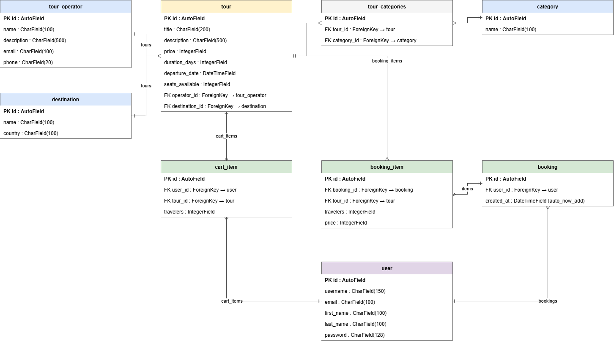

# TourHub — бекенд

REST API каталогу турів від різних туроператорів. Тури можна переглядати за туроператорами й напрямками. Зареєстровані користувачі додають і редагують тури, а адміністратори керують усіма даними.

Стек: Django 6.1, Django REST Framework, djangorestframework-simplejwt (JWT), django-cors-headers, SQLite.

Фронтенд (окремий репозиторій): [TourHub_front](https://github.com/HliebOcheretianyi/TourHub_front)

## Зміст

- [Запуск](#запуск)
- [Структура проєкту](#структура-проєкту)
- [Загальні правила API](#загальні-правила-api)
- [Автентифікація (JWT)](#автентифікація-jwt)
- [Права доступу](#права-доступу)
- [Ендпоінти: auth](#ендпоінти-auth)
- [Ендпоінти: тури, туроператори, напрямки, категорії](#ендпоінти-тури-туроператори-напрямки-категорії)
- [Postman](#postman)
- [Схема бази даних](#схема-бази-даних)

## Запуск

```bash
git clone https://github.com/HliebOcheretianyi/TourHub.git
cd TourHub
python -m venv venv
venv\Scripts\activate                  # Linux/macOS: source venv/bin/activate
pip install -r requirements.txt
copy .env.example .env                 # Linux/macOS: cp .env.example .env, потім впишіть SECRET_KEY
python manage.py migrate
python manage.py createsuperuser       # адміністратор (is_staff = True)
python manage.py runserver
```

- API: http://localhost:8000/api/v1/
- Адмін-панель: http://localhost:8000/admin/ (там же додаються категорії)
- CORS дозволено для фронтенду на `http://localhost:5173`

## Структура проєкту

| Папка | Що містить |
|---|---|
| `tourhub/` | Налаштування проєкту, кореневі URL-и |
| `tours/` | Моделі, серіалізатори та views для турів, туроператорів, напрямків і категорій |
| `accounts/` | Реєстрація, логін (JWT), оновлення токена, `/me`, класи permissions |
| `postman/` | Postman-колекція з усіма запитами |

## Загальні правила API

- Базовий префікс: `/api/v1/`. Усі URL закінчуються на `/`.
- Формат даних: JSON (`Content-Type: application/json`).
- Оновлення робиться лише через `PUT`, тож передавайте повний об'єкт.
- Ціни задаються цілими числами в гривнях. Дати мають формат ISO 8601, наприклад `2026-12-20T08:00:00Z`.
- Зв'язані об'єкти передаються й повертаються як id: `"operator": 3`, `"categories": [1, 2]`.

Формати помилок:

```json
{ "detail": "Тур з id=5 не знайдено" }
```

```json
{ "email": ["Введіть коректну адресу електронної пошти."], "password_confirm": ["Паролі не збігаються."] }
```

Перший формат описує помилку всього запиту, другий є помилкою валідації (`400`) з переліком повідомлень для кожного поля.

| Статус | Значення |
|---|---|
| `200` | OK |
| `201` | Створено |
| `204` | Видалено, тіла немає |
| `400` | Некоректні дані |
| `401` | Немає токена або він недійсний чи прострочений |
| `403` | Токен валідний, але недостатньо прав |
| `404` | Об'єкт не знайдено |
| `409` | Конфлікт: не можна видалити туроператора або напрямок, до яких прив'язані тури |

## Автентифікація (JWT)

Використовуються два токени:

| Токен | Час життя | Для чого |
|---|---|---|
| `access` | 5 хвилин | Передається в кожному захищеному запиті |
| `refresh` | 1 день | Потрібен лише для отримання нового `access` |

**Як передавати токен:** заголовок

```
Authorization: Bearer <access>
```

**Схема роботи:**

1. `POST /api/v1/auth/login/` повертає `access` і `refresh`.
2. Захищені запити надсилаються з заголовком `Authorization: Bearer <access>`.
3. Коли `access` прострочується, сервер відповідає `401` з `"code": "token_not_valid"`.
4. Клієнт надсилає `POST /api/v1/auth/token/refresh/` з `refresh`, отримує новий `access` і повторює запит.
5. Якщо прострочився і `refresh`, користувач логіниться знову.

**Logout** виконується на клієнті: фронтенд видаляє обидва токени зі сховища. Окремого ендпоінта немає.

Паролі зберігаються лише в захешованому вигляді (PBKDF2, стандартний механізм Django).

## Права доступу

Ролі:

- **анонім** — запит без токена;
- **користувач** — будь-який зареєстрований користувач;
- **адміністратор** — користувач з `is_staff = True` (створюється через `createsuperuser` або в адмін-панелі).

| Дія | Анонім | Користувач | Адмін |
|---|---|---|---|
| `GET` будь-яких турів, туроператорів, напрямків, категорій | ✅ | ✅ | ✅ |
| `POST /tours/`, `PUT /tours/{id}/` | 401 | ✅ | ✅ |
| `DELETE /tours/{id}/` | 401 | 403 | ✅ |
| `POST`, `PUT`, `DELETE` для `/operators/` і `/destinations/` | 401 | 403 | ✅ |
| `GET /auth/me/` | 401 | ✅ | ✅ |

Приклади відповідей:

```json
// 401, запит без токена
{ "detail": "Облікові дані не були надані." }
```

```json
// 403, користувач намагається видалити тур
{ "detail": "Видаляти тури можуть лише адміністратори." }
```

```json
// 403, користувач намагається змінити туроператора чи напрямок
{ "detail": "Ця дія доступна лише адміністраторам." }
```

## Ендпоінти: auth

| Метод | URL | Токен | Призначення |
|---|---|---|---|
| POST | `/api/v1/auth/register/` | — | Реєстрація |
| POST | `/api/v1/auth/login/` | — | Логін, видає `access` і `refresh` |
| POST | `/api/v1/auth/token/refresh/` | — | Новий `access` за `refresh` |
| GET | `/api/v1/auth/me/` | `access` | Дані поточного користувача |

### POST `/api/v1/auth/register/`

| Поле | Обов'язкове | Обмеження |
|---|---|---|
| `username` | так | до 150 символів; літери, цифри, `@ . + - _`; унікальний |
| `first_name` | ні | до 150 символів, може бути порожнім |
| `last_name` | ні | до 150 символів, може бути порожнім |
| `email` | так | коректний формат, до 254 символів, унікальний |
| `password` | так | від 8 до 128 символів; не лише цифри, не надто поширений, не схожий на username чи email |
| `password_confirm` | так | має збігатися з `password` |

Request:

```json
{
  "username": "olena",
  "first_name": "Олена",
  "last_name": "Коваль",
  "email": "olena@example.com",
  "password": "Sunny-Trip-2026",
  "password_confirm": "Sunny-Trip-2026"
}
```

Response `201`:

```json
{ "id": 7, "username": "olena", "first_name": "Олена", "last_name": "Коваль", "email": "olena@example.com" }
```

Response `400`, приклад:

```json
{
  "username": ["Користувач з таким ім'ям вже існує."],
  "email": ["Користувач з таким email уже існує."],
  "password_confirm": ["Паролі не збігаються."]
}
```

### POST `/api/v1/auth/login/`

Request:

```json
{ "username": "olena", "password": "Sunny-Trip-2026" }
```

Response `200`:

```json
{ "refresh": "eyJhbGciOiJIUzI1NiIs...", "access": "eyJhbGciOiJIUzI1NiIs..." }
```

Payload `access`-токена, крім стандартних `user_id`, `exp`, `iat`, `jti`, містить `username` і `is_staff`.

- `400` — не передано `username` або `password`.
- `401` — невірні облікові дані: `{ "detail": "No active account found with the given credentials" }`.

### POST `/api/v1/auth/token/refresh/`

Request:

```json
{ "refresh": "eyJhbGciOiJIUzI1NiIs..." }
```

Response `200`:

```json
{ "access": "eyJhbGciOiJIUzI1NiIs..." }
```

- `400` — не передано `refresh`.
- `401` — `refresh` недійсний або прострочений: `{ "detail": "Token is invalid or expired", "code": "token_not_valid" }`.

### GET `/api/v1/auth/me/`

Заголовок: `Authorization: Bearer <access>`

Response `200`:

```json
{ "id": 7, "username": "olena", "first_name": "Олена", "last_name": "Коваль", "email": "olena@example.com", "is_staff": false }
```

- `401` — немає токена або він прострочений.

## Ендпоінти: тури, туроператори, напрямки, категорії

Для запитів на запис потрібен заголовок `Authorization: Bearer <access>`, див. [Права доступу](#права-доступу).

### Тури

| Метод | URL | Доступ | Призначення |
|---|---|---|---|
| GET | `/api/v1/tours/` | усі | Список турів |
| GET | `/api/v1/tours/{id}/` | усі | Один тур |
| POST | `/api/v1/tours/` | користувач, адмін | Створити тур |
| PUT | `/api/v1/tours/{id}/` | користувач, адмін | Оновити тур |
| DELETE | `/api/v1/tours/{id}/` | адмін | Видалити тур |

Об'єкт туру (так виглядає response `GET` і так само формується request body для `POST`/`PUT`, але без `id`):

```json
{
  "id": 1,
  "title": "Тиждень у Єгипті: все включено",
  "description": "Перельот, готель 5*, харчування все включено, трансфер.",
  "price": 28500,
  "duration_days": 7,
  "departure_date": "2026-12-20T08:00:00Z",
  "seats_available": 12,
  "operator": 3,
  "destination": 2,
  "categories": [1]
}
```

| Запит | Статуси |
|---|---|
| `GET /tours/` | `200` (масив турів) |
| `GET /tours/{id}/` | `200`, `404` |
| `POST /tours/` | `201`, `400`, `401` |
| `PUT /tours/{id}/` | `200`, `400`, `401`, `404` |
| `DELETE /tours/{id}/` | `204`, `401`, `403`, `404` |

### Туроператори

| Метод | URL | Доступ | Призначення |
|---|---|---|---|
| GET | `/api/v1/operators/` | усі | Список туроператорів |
| GET | `/api/v1/operators/{id}/` | усі | Один туроператор |
| GET | `/api/v1/operators/{id}/tours/` | усі | Усі тури туроператора |
| POST | `/api/v1/operators/` | адмін | Створити |
| PUT | `/api/v1/operators/{id}/` | адмін | Оновити |
| DELETE | `/api/v1/operators/{id}/` | адмін | Видалити |

```json
{ "id": 3, "name": "Sunny Travel", "description": "Пляжні та екскурсійні тури з 2010 року.", "email": "info@sunny.example", "phone": "+380441234567" }
```

| Запит | Статуси |
|---|---|
| `GET /operators/`, `GET /operators/{id}/`, `GET /operators/{id}/tours/` | `200`, `404` |
| `POST /operators/` | `201`, `400`, `401`, `403` |
| `PUT /operators/{id}/` | `200`, `400`, `401`, `403`, `404` |
| `DELETE /operators/{id}/` | `204`, `401`, `403`, `404`, `409` (за туроператором є тури) |

### Напрямки

| Метод | URL | Доступ | Призначення |
|---|---|---|---|
| GET | `/api/v1/destinations/` | усі | Список напрямків |
| GET | `/api/v1/destinations/{id}/` | усі | Один напрямок |
| GET | `/api/v1/destinations/{id}/tours/` | усі | Усі тури в напрямок |
| POST | `/api/v1/destinations/` | адмін | Створити |
| PUT | `/api/v1/destinations/{id}/` | адмін | Оновити |
| DELETE | `/api/v1/destinations/{id}/` | адмін | Видалити |

```json
{ "id": 2, "name": "Хургада", "country": "Єгипет" }
```

Статуси такі самі, як у туроператорів, зокрема `409` при видаленні напрямку, до якого прив'язані тури.

### Категорії

| Метод | URL | Доступ | Призначення |
|---|---|---|---|
| GET | `/api/v1/categories/` | усі | Список типів відпочинку |

```json
[ { "id": 1, "name": "Пляжний відпочинок" }, { "id": 2, "name": "Гірськолижний" } ]
```

Категорії додаються через адмін-панель.

#
## Схема бази даних


